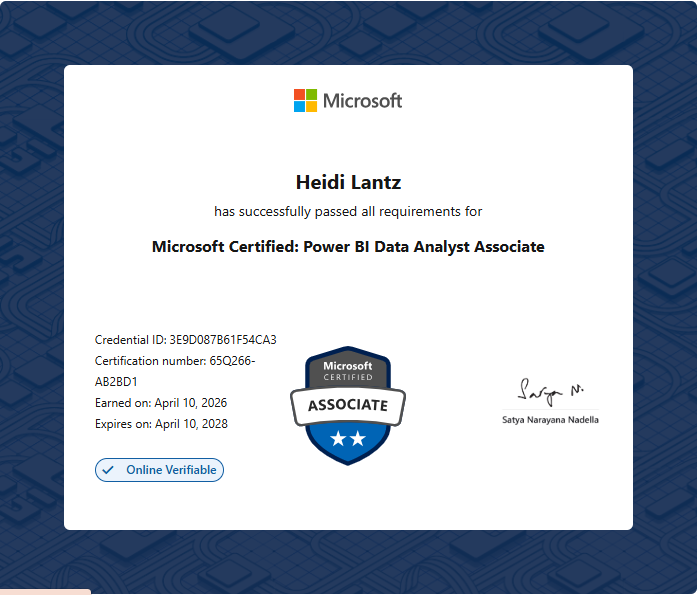
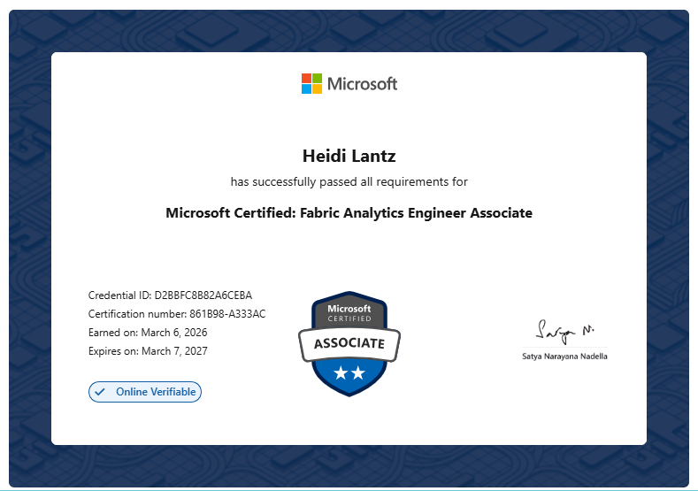
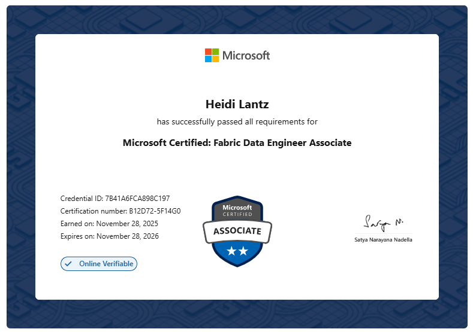
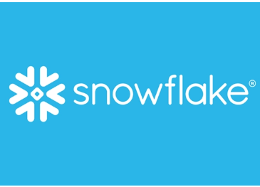
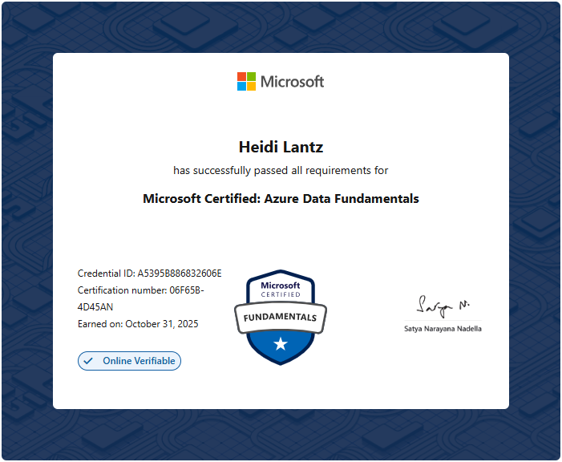

# Technical certifications

::: {.cert-grid}

::: {.cert .card-blue}
### PL-300: Power BI Data Analyst Associate
{.lightbox}
:::

::: {.cert .card-blue}
### DP-600: Fabric Analytics Engineer Associate
{.lightbox}
:::

::: {.cert .card-blue}
### DP-700: Fabric Data Engineer Associate
{.lightbox}
:::

::: {.cert .card-green}
### Snowflake SnowPro Core
{.lightbox}
:::

::: {.cert .card-blue}
### SC-401: Information Security Administrator Associate
{.lightbox}
:::

::: {.cert .card-blue}
### DP-900: Azure Data Fundamentals
{.lightbox}
:::

::: {.cert .card-blue}
### SC-900: Security, Compliance, and Identity Fundamentals
{.lightbox}
:::

::: {.cert .card-blue}
### AZ-900: Azure Fundamentals
{.lightbox}
:::

:::

# Course certificates

::: {.cert-grid}

::: {.cert .card-purple}
### Databricks: Lakehouse Architecture
{.lightbox}
:::

::: {.cert .card-purple}
### Long View Systems CDP-101
{.lightbox}
:::

::: {.cert .card-purple}
### Long View Systems CDP-201
{.lightbox}
:::

::: {.cert .card-purple}
### Research Ethics (TCPS 2 CORE)
{.lightbox}
:::

:::
