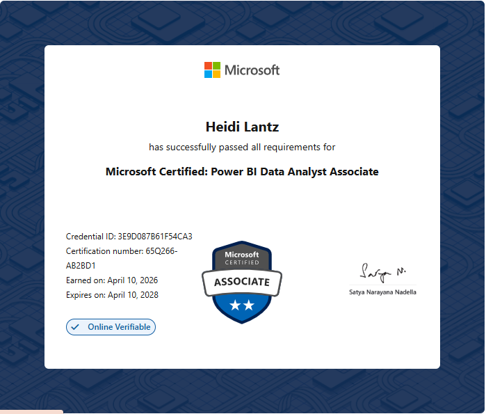
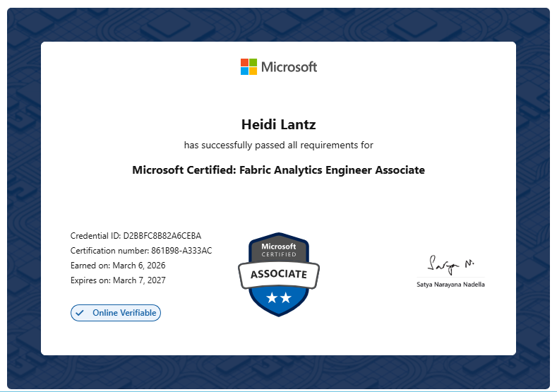
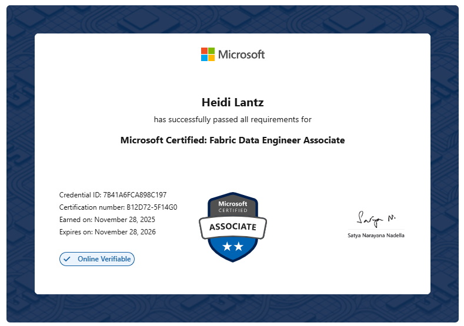
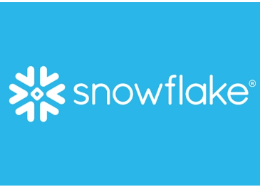
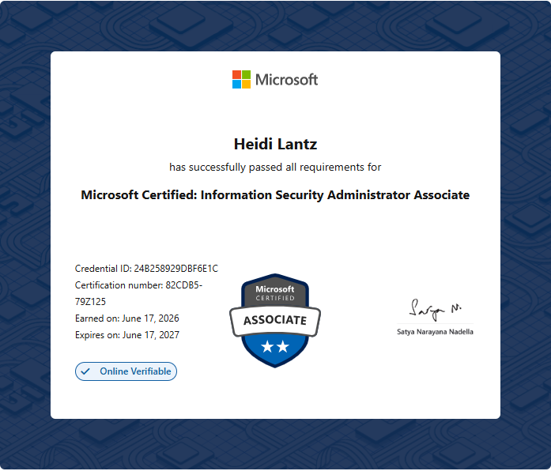
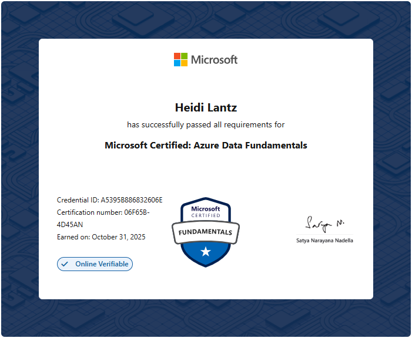
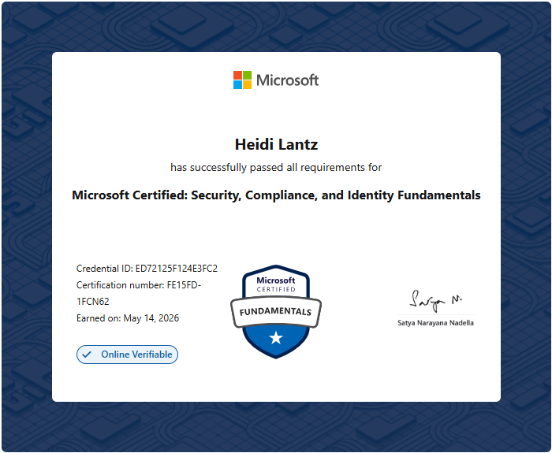

# Technical certifications

::: {.cert-grid}

::: {.cert .card-blue}
### PL-300: Power BI Data Analyst Associate
{.lightbox}
<!-- Preparing and modeling data, writing DAX, and building secure, interactive Power BI reports and dashboards  - Achieved: April 2025 and renewed -->
:::

::: {.cert .card-blue}
### DP-600: Fabric Analytics Engineer Associate
{.lightbox}
<!-- Designing enterprise-scale analytics solutions in Fabric, from semantic models and lakehouse/warehouse design to performance optimization and deployment  - Achieved: March 2025 and renewed -->
:::

::: {.cert .card-blue}
### DP-700: Fabric Data Engineer Associate
{.lightbox}
<!-- Designing and building data ingestion, transformation, and orchestration pipelines in Microsoft Fabric using lakehouses, warehouses, PySpark, SQL, and Dataflows  - Achieved: November 2025 and renewed -->
:::

::: {.cert .card-green}
### Snowflake SnowPro Core
{.lightbox}
<!-- Snowflake platform fundamentals including architecture, data loading and transformation, performance tuning, and access control and security  -->
<!-- Achieved: December 2025 -->
:::

::: {.cert .card-blue}
### SC-401: Information Security Administrator Associate
{.lightbox}
<!-- Implementing data protection, information governance, and compliance controls such as sensitivity labels, DLP, and insider risk management across Microsoft 365 and cloud environments   -->
<!-- Achieved: June 2026 -->
:::

::: {.cert .card-blue}
### DP-900: Azure Data Fundamentals
{.lightbox}
<!-- Core data concepts and Azure data services, covering relational and non-relational data, storage, and analytics workloads  -->
<!-- Achieved: Oct 2025 -->
:::

::: {.cert .card-blue}
### SC-900: Security, Compliance, and Identity Fundamentals
{.lightbox}
<!-- Foundations of security, compliance, and identity, including Microsoft Entra ID, access management, and threat protection  -->
<!-- Achieved May 2026 -->
:::

::: {.cert .card-blue}
### AZ-900: Azure Fundamentals
{.lightbox}
<!-- Covers general cloud concepts, core Azure services, and Azure management and governance  -->
<!-- Achieved: Oct 2025 -->
:::

:::

# Course certificates

::: {.cert-grid}

::: {.cert .card-purple}
### Databricks: Lakehouse Architecture
{.lightbox}
:::

::: {.cert .card-purple}
### Long View Systems CDP-101
{.lightbox}
:::

::: {.cert .card-purple}
### Long View Systems CDP-201
{.lightbox}
:::

::: {.cert .card-purple}
### Research Ethics (TCPS 2 CORE)
{.lightbox}
:::

:::
